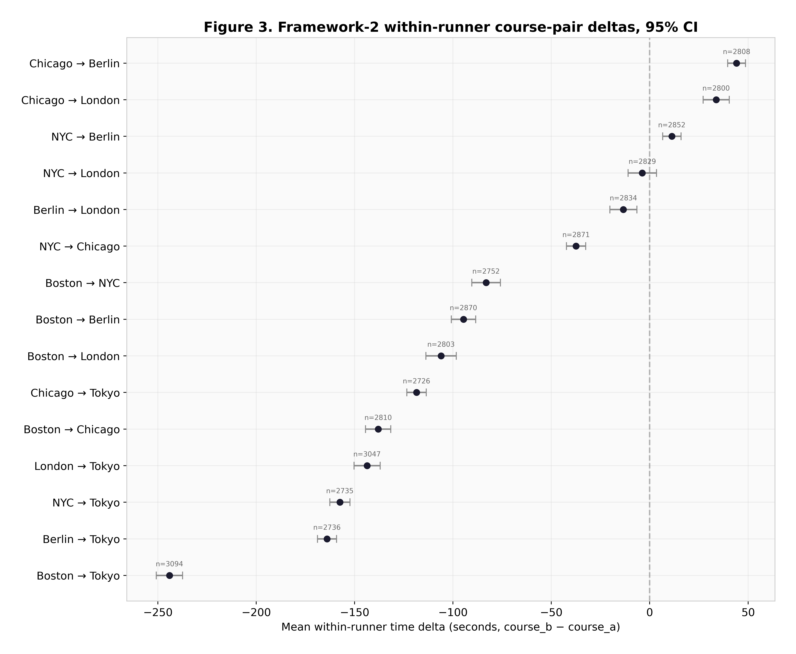

# Marathon Majors course difficulty

How many seconds does Boston cost compared with Berlin? This repo tests three ways of answering that on a simulated elite field, where each course's penalty is set in code and the right answer is known.

[Live site](https://lyhjeremy.github.io/marathon-majors-course-difficulty/) · [Write-up](https://lyhjeremy.github.io/marathon-majors-course-difficulty/overview/) · [Full report (Markdown)](writeup.md) · [Notebook](notebooks/majors_course_difficulty_analysis.ipynb)

Design and copy follow [these standards](https://github.com/lyhjeremy/lyhjeremy/blob/main/DESIGN_STANDARDS.md).

> **Correction, October 2026.** Earlier versions of this README described the race results as compiled from World Athletics, ARRS and MarathonGuide, and reported Boston's +101 s as a property of the real course. The results are simulated by `src/build_data.py`. The PDF and Word files in `reports/` still carry the old framing.

## Results

Seconds slower than Berlin for the same runner. "Planted" is the penalty written into the simulation.

| Course | Planted | Within-runner paired (95% CI) | Weather-normalized top 10 | Grade-adjusted (Minetti) |
|:--|--:|--:|--:|--:|
| Boston | 105 | +101.0 (98.8 to 103.1) | +100.1 | −89.4 |
| New York | 85 | +77.7 (75.5 to 79.7) | +80.3 | +15.4 |
| London | 35 | +30.7 (28.6 to 32.8) | +29.7 | +3.6 |
| Tokyo | 28 | +21.0 (18.7 to 23.2) | +16.9 | −16.7 |
| Chicago | 12 | +11.4 (9.2 to 13.5) | +11.4 | −3.5 |

The paired method recovers every planted penalty to within 7.3 s and the top-10 method to within 11.1 s, though both read every course low. The Minetti energy-cost model sees only the elevation profiles and scores Boston 89 s faster than Berlin, because of its 136 m net descent; the simulation has no elevation term, so that number is not a test of the model. A weighted composite index (Berlin = 1.000) puts Boston at 1.0092 and New York at 1.0089. The [write-up page](https://lyhjeremy.github.io/marathon-majors-course-difficulty/overview/) has a version of the composite where you can set the three weights yourself.



## Method

`src/build_data.py` draws 400 men and 400 women with a fixed flat-course ability, enters 150 of them in each race from 2015 to 2024 (2020 excluded), and sets each finish time to ability + course penalty + weather penalty + Gaussian noise. The top 100 per gender are kept: 10,800 results and 42,567 same-athlete course pairs within 18 months. Weather is a hand-entered table per edition.

`src/analysis.py` then runs three estimators:

1. **Grade-adjusted prediction.** The Minetti et al. (2002) energy-cost polynomial integrated over a 40/40/20 climb/descent/flat approximation of each course, plus grade and turn penalties.
2. **Within-runner paired comparison.** Weather-normalized same-athlete time differences, least-squares fixed effects per course with Berlin at zero, 2,000-resample bootstrap confidence intervals.
3. **Weather-normalized top-10 average.** Top-10 times divided by a heat, humidity and wind multiplier after Maughan (2010) and El Helou et al. (2012).

A Course Difficulty Index combines the three with weights 0.15, 0.50 and 0.35. Sensitivity runs drop the elevation model, restrict to sub-2:10 men, or swap in a linear gain-and-loss elevation model, and only the last one changes the order (New York moves above Boston).

Stack: Python, pandas, NumPy, SciPy, matplotlib, seaborn, Jupyter. ReportLab and a Node `docx` script built the PDF and Word reports.

## How to run

```bash
git clone https://github.com/lyhjeremy/marathon-majors-course-difficulty.git
cd marathon-majors-course-difficulty
pip install -r requirements.txt
python src/build_data.py      # regenerate data/*.csv (seed 42)
python src/analysis.py        # 8 figures + outputs/analysis_results.csv
python src/generate_html.py   # web/index.html, the standalone HTML report
```

## Repository layout

| Path | Contents |
|:--|:--|
| `src/` | Simulation, analysis, and the HTML, PDF and Word report generators |
| `data/` | The four CSVs (simulated results, pairs, weather, course profiles) |
| `outputs/` | Figures and `analysis_results.csv` |
| `notebooks/` | The analysis as a Jupyter notebook |
| `web/` | Standalone HTML report with embedded figures |
| `overview/` | The write-up page on the live site |
| `reports/` | PDF and Word reports (older framing, see correction above) |

## Limitations

No number here measures an actual course. The weather correction divides by the same curve that generated the times, which makes it exact by construction, and the simulation has no pacing, fatigue or field-selection effects. The course profiles are hand-entered. The next step is to run the same code on top-100 results from the races themselves and keep this simulation as the recovery test.

## License

[MIT](LICENSE) © 2026 Jeremy Lee
