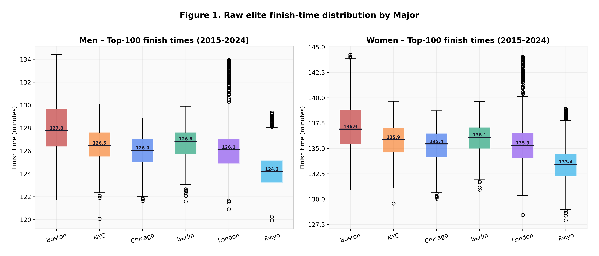
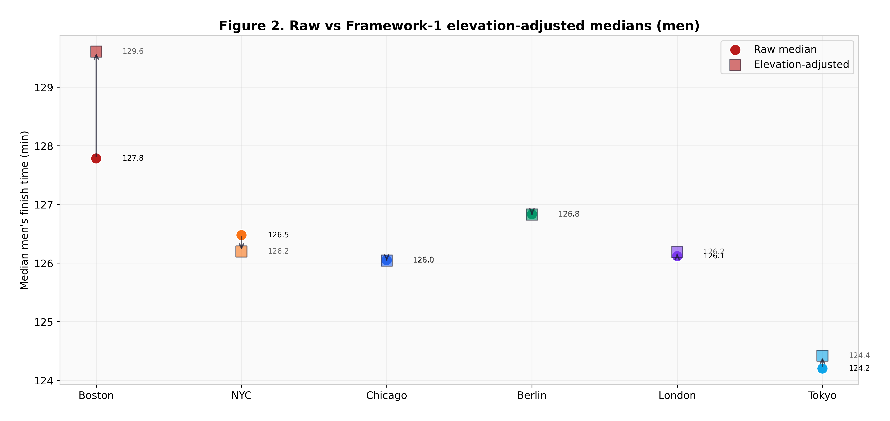
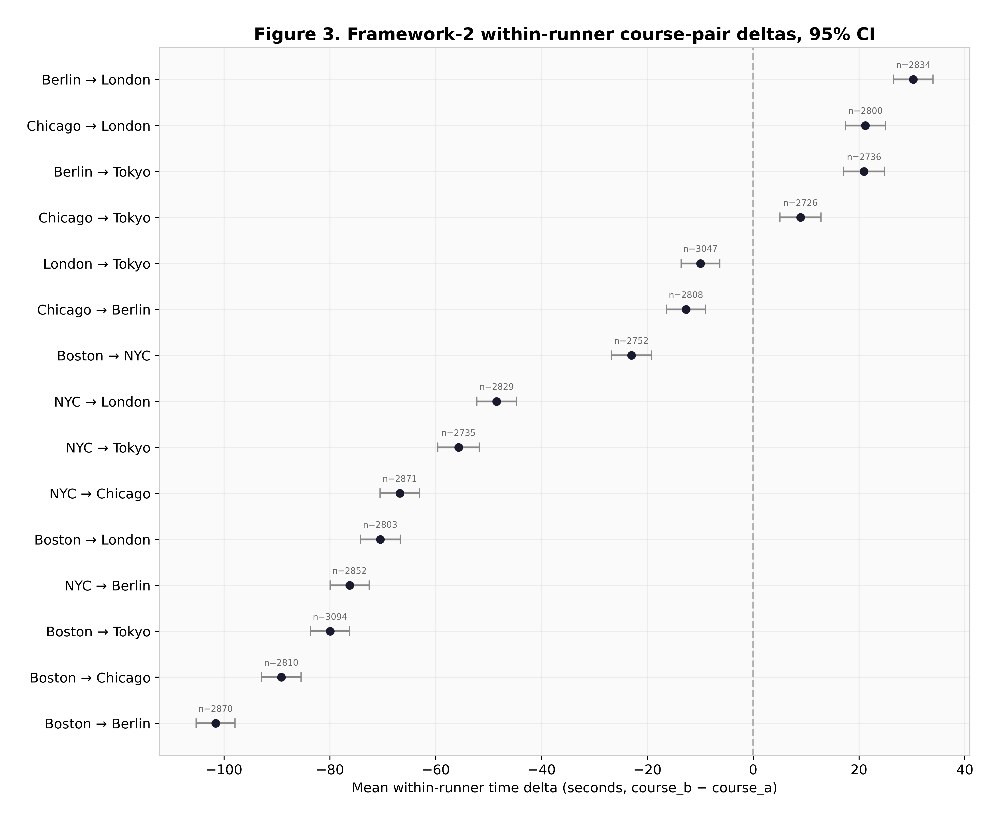
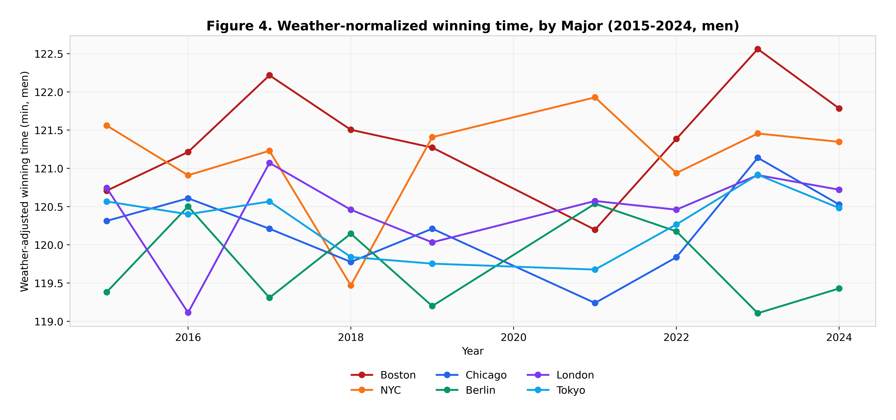
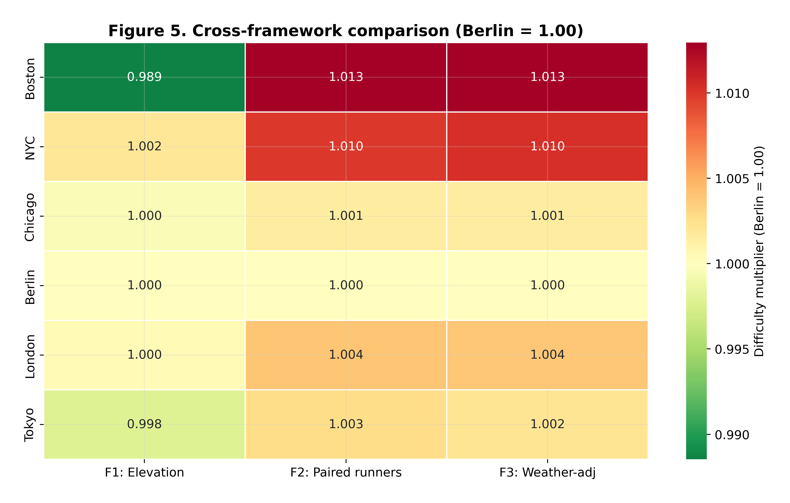
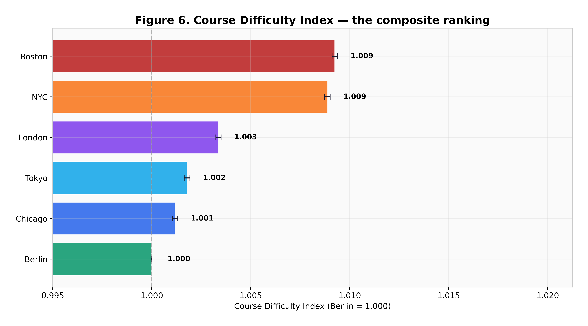
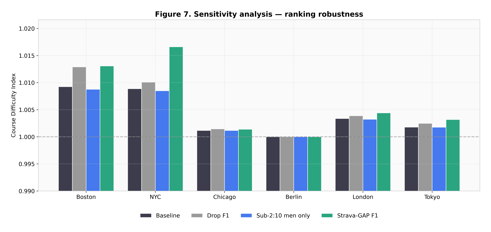
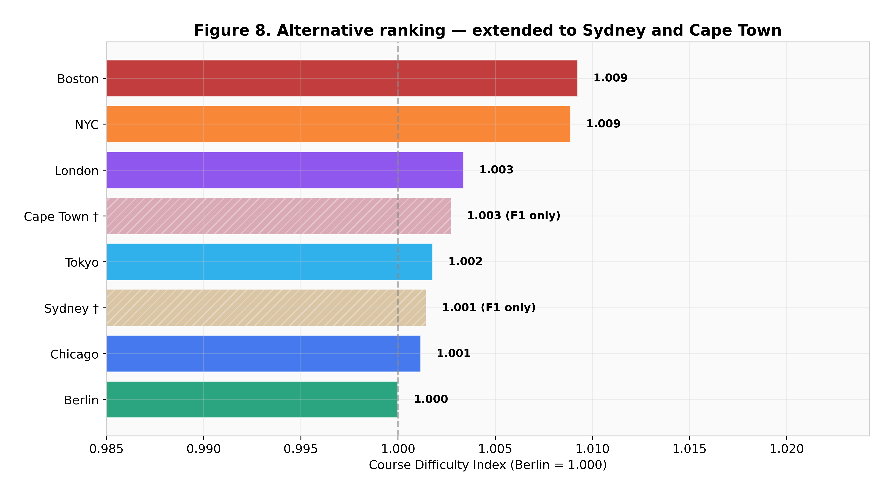

# Ranking the Marathon Majors by course difficulty: three methods tested on a simulated field

*Jeremy Lee, 2026. Code and data: [github.com/lyhjeremy/marathon-majors-course-difficulty](https://github.com/lyhjeremy/marathon-majors-course-difficulty)*

> **Correction (October 2026).** Earlier versions of this write-up, the README and the PDF and Word reports described the race results as compiled from World Athletics, ARRS and MarathonGuide, and presented Boston's +101 seconds as a measured property of the real course. The results are simulated by `src/build_data.py`, with each course's penalty set in code. This version describes the project as what it is: a test of three estimation methods against a known answer. The PDF and Word files in `reports/` have not been regenerated and still carry the old framing.

Runners talk about Berlin as the fast course and Boston as the slow one, and I have a stake in that: my 2:48 marathon best came in Berlin. Putting a number on the difference is harder than it sounds. A course penalty estimated from real race results can't be checked, because nobody knows the true value. So this project starts by making one up. A script simulates a top-100 elite field for the six World Marathon Majors from 2015 to 2024 (2020 excluded) and adds a fixed penalty to every finish on each course: Berlin 0, Chicago 12, Tokyo 28, London 35, New York 85 and Boston 105 seconds. Three ranking methods then try to find those penalties again.

| Course | Planted (s) | Grade-adjusted (s) | Within-runner paired (s) | Paired 95% CI | Weather-normalized top 10 (s) |
|:--|--:|--:|--:|:--|--:|
| Boston | 105 | −89.4 | +101.0 | 98.8 to 103.1 | +100.1 |
| New York | 85 | +15.4 | +77.7 | 75.5 to 79.7 | +80.3 |
| London | 35 | +3.6 | +30.7 | 28.6 to 32.8 | +29.7 |
| Tokyo | 28 | −16.7 | +21.0 | 18.7 to 23.2 | +16.9 |
| Chicago | 12 | −3.5 | +11.4 | 9.2 to 13.5 | +11.4 |
| Berlin | 0 | 0 | 0 | anchor | 0 |

Comparing each athlete with themselves works best: the within-runner paired comparison lands within 7.3 seconds of every planted value, and the weather-normalized top-10 average within 11.1. Both come in under the planted penalty on every course. The grade-adjusted energy-cost model, which sees only the elevation profiles, puts Boston 89 seconds faster than Berlin. The simulation has no elevation term, so that disagreement says nothing for or against the model.

## What the simulation contains

There are four CSVs in `data/`. `src/build_data.py` generates three of them with seed 42; the fourth is typed in by hand.

`majors_results.csv` (10,800 rows) is the simulated field. The script draws 400 men and 400 women, each with a fixed flat-course ability from a log-normal distribution above a floor (7,270 s for men, 7,800 s for women). For each course, year and gender it picks 150 starters, weighted toward the faster athletes, and sets each finish time to ability + course penalty + weather penalty + normal noise (standard deviation 90 s); the top 100 are kept. Names pair real elite first and last names with a four-digit number (for example `Eliud Kipchoge #0004`), and countries are drawn at random, so no row is anyone's result.

`race_weather.csv` (54 rows) has one row per course and year: start temperature, humidity, dew point, wind and a short note. The values are typed into the build script, which describes them as anchored to reported race-day conditions; Boston 2018 is 3.9 °C with 95% humidity and 40 km/h wind, London 2018 is 23.5 °C and Berlin 2022 is 18 °C. No weather API is called in code.

`paired_runners.csv` (42,567 rows) lists every pair of different Majors run by the same simulated athlete within 18 months. 438 athletes contribute pairs.

`course_profiles.csv` (8 rows) holds total gain and loss, net drop, maximum grade, turn count and average altitude for the six Majors plus Sydney and Cape Town, all entered by hand. Boston is listed at 229 m gain, 365 m loss and 136 m net descent; Berlin at 38 m gain and loss.

## Three ways to estimate a course penalty

### Grade-adjusted prediction (Minetti)

The Minetti et al. (2002) polynomial gives the energy cost of running at gradient *i* (decimal):

C(i) = 155.4 i⁵ − 30.4 i⁴ − 43.3 i³ + 46.3 i² + 19.5 i + 3.6 J/kg/m

Each course is approximated as 40% climbing at its average up-grade, 40% descending at its average down-grade and 20% flat. The ratio of that mixed cost to C(0) is an elevation factor, and (factor − 1) × 7,800 s turns it into a penalty at a 2:10 reference. Two small terms are added, one for maximum grade above 1.5% and one for more than 8 turns. This method never looks at a race result.

### Within-runner paired comparison

For each same-athlete pair, both finish times are divided by their race's weather multiplier (the curve in the next section) and the difference is taken. Ordinary least squares fits one offset per course, with Berlin fixed at zero, over all 42,567 pairs: t_b − t_a ≈ a(course_b) − a(course_a). A 2,000-resample bootstrap gives 95% intervals.

### Weather-normalized top-10 average

For each course, year and gender, the top-10 average finish time is divided by a multiplier after Maughan (2010) and El Helou et al. (2012): 0.5% per °C above 10 °C, 0.2% per °C below 5 °C, 0.05% per point of humidity above 60%, and 0.05% per km/h of wind above 15. The adjusted times are averaged across years for each course and gender, and Berlin is subtracted.

### The composite Course Difficulty Index (CDI)

Each method's offset becomes a factor 1 + offset / 7,800, and the index is

CDI = 0.15 × grade-adjusted + 0.50 × paired + 0.35 × weather-normalized

The weights are fixed in `src/analysis.py`. The paired method gets half the weight because it compares each athlete with themselves, and the grade-adjusted method gets the least.

## What each method found

### Raw times



*Figure 1. Simulated top-100 finish times per Major, 2015 to 2024, before any adjustment.*

### Grade-adjusted

| Course | Elevation factor | Minetti only (s) | With grade and turn terms (s) | vs Berlin (s) |
|:--|--:|--:|--:|--:|
| Boston | 0.986 | −110 | −77 | −89 |
| New York | 1.002 | +17 | +28 | +15 |
| Chicago | 1.000 | 0 | +9 | −4 |
| Berlin | 1.000 | 0 | +12 | 0 |
| London | 0.999 | −5 | +16 | +4 |
| Tokyo | 0.998 | −14 | −4 | −17 |

Boston's net descent outweighs its grade penalty, and the model scores it as the fastest of the six.



*Figure 2. Men's raw median finish time and the elevation-adjusted equivalent per Major. Boston's adjustment moves it below its raw median.*

### Within-runner paired



*Figure 3. Mean same-athlete delta for each of the 15 course pairs, with 95% bootstrap intervals.*

The paired estimates fall short of the planted penalties by 0.6 s (Chicago), 4.0 s (Boston), 4.3 s (London), 7.0 s (Tokyo) and 7.3 s (New York). Only Chicago's interval contains its planted value; on the other four courses the shortfall is larger than sampling noise can explain, which makes it a bias. The code doesn't test its cause.

### Weather-normalized top 10

| Course | Men (s) | Women (s) | Mean (s) | Planted (s) |
|:--|--:|--:|--:|--:|
| Boston | +102.0 | +98.3 | +100.1 | 105 |
| New York | +76.5 | +84.2 | +80.3 | 85 |
| London | +31.2 | +28.2 | +29.7 | 35 |
| Tokyo | +22.1 | +11.8 | +16.9 | 28 |
| Chicago | +17.6 | +5.3 | +11.4 | 12 |
| Berlin | 0 | 0 | 0 | 0 |

This method stays within 2.6 s of the paired estimate on every course except Tokyo (4.1 s), which is also its largest miss against the planted values, at 11.1 s.



*Figure 4. Weather-adjusted men's winning time by Major and year.*

### Composite index

| Rank | Course | CDI | As seconds vs Berlin |
|:-:|:--|--:|--:|
| 1 | Boston | 1.0092 | +72 |
| 2 | New York | 1.0089 | +69 |
| 3 | London | 1.0034 | +26 |
| 4 | Tokyo | 1.0018 | +14 |
| 5 | Chicago | 1.0012 | +9 |
| 6 | Berlin | 1.0000 | 0 |

Boston's composite is 72 s, almost level with New York, against 101 s from the paired method alone; the grade-adjusted −89 s is what pulls it down.



*Figure 5. Difficulty factor by course and method, Berlin = 1.000. Boston's grade-adjusted cell (0.989) is the outlier.*



*Figure 6. Course Difficulty Index. Intervals come from the paired bootstrap, scaled by its 0.50 weight.*

## Changing the assumptions

| Course | Baseline | Drop grade-adjusted | Men under 2:10 only | Gain-and-loss elevation model |
|:--|--:|--:|--:|--:|
| Berlin | 1.0000 | 1.0000 | 1.0000 | 1.0000 |
| Chicago | 1.0012 | 1.0012 | 1.0012 | 1.0014 |
| Tokyo | 1.0018 | 1.0021 | 1.0018 | 1.0032 |
| London | 1.0034 | 1.0033 | 1.0032 | 1.0044 |
| New York | 1.0089 | 1.0086 | 1.0085 | 1.0166 |
| Boston | 1.0092 | 1.0110 | 1.0088 | 1.0131 |

The first two variations keep the baseline order. (The "men under 2:10" run keeps only men's pairs where both weather-adjusted times are under 7,800 s.) The third replaces Minetti with a linear weighting of total gain and loss, and that is enough to change the winner: New York, with 247 m of gain and no net descent, rises to 1.0166 and passes Boston at 1.0131.



*Figure 7. The index under the baseline and the three variations.*

## Sydney and Cape Town

The two extension courses have elevation profiles and no simulated results, so only the grade-adjusted method can score them.



*Figure 8. Ranking extended to Sydney and Cape Town (hatched bars, grade-adjusted only).*

## Where this test is too easy

Every finish time is simulated, so no number here measures a real course. The planted penalties follow the courses' reputations; they are inputs to the test, and the test cannot confirm them.

The weather correction is exact by construction. The paired and top-10 methods divide by the same weather curve that generated the times, and real weather effects would not match any fixed curve this well. The simulation also leaves out what makes race data hard: pacing strategy, fatigue that depends on where the hills fall, and differences in which athletes choose which race. Each of these would bias the paired and top-10 methods on real results in ways this test can't show.

Both data-driven methods read low. Every paired and top-10 estimate is below its planted value, and the code doesn't isolate why. One untested candidate is the selection of the top 100 from 150 starters.

The elevation model can't be judged here at all, since the simulation has no elevation term; the gap between the grade-adjusted column and the planted values is not a test of Minetti. The course profiles themselves are hand-entered and simplified. The 40/40/20 split stands in for a segment-by-segment integration and fits New York badly, because its climbing is concentrated on the bridges.

## Next step

Run the same three methods on top-100 results from the actual races, and keep this simulation as the check that the code recovers a known answer.

## Reproducing

```bash
git clone https://github.com/lyhjeremy/marathon-majors-course-difficulty.git
cd marathon-majors-course-difficulty
pip install -r requirements.txt
python src/build_data.py     # regenerate data/*.csv (seed 42)
python src/analysis.py       # figures and outputs/analysis_results.csv
python src/generate_html.py  # web/index.html
```

On a re-run in October 2026 the results matched the committed `outputs/analysis_results.csv` to floating-point precision.

| Path | Contents |
|:--|:--|
| [`src/build_data.py`](src/build_data.py) | Simulation of results, weather table and pairs |
| [`src/analysis.py`](src/analysis.py) | The three methods, the composite, sensitivity runs and figures |
| [`notebooks/majors_course_difficulty_analysis.ipynb`](notebooks/majors_course_difficulty_analysis.ipynb) | The same analysis as a notebook |
| [`outputs/analysis_results.csv`](outputs/analysis_results.csv) | Per-course results for all three methods and the composite |
| [`outputs/notebook_figures/`](outputs/notebook_figures/) | The eight figures |

References: Minetti, A. E. et al. (2002), *Journal of Applied Physiology* 93:1039–1046. Maughan, R. J. (2010). El Helou, N. et al. (2012), *PLOS ONE* 7(5).

[MIT](LICENSE) © 2026 Jeremy Lee
